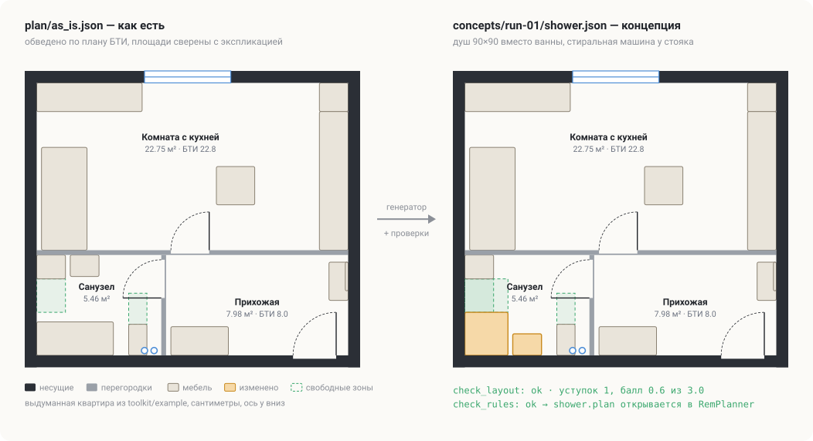

# remplanner-skills

[](https://github.com/troyan-dy/remplanner-skills/actions/workflows/selftest.yml)
[](#установка)
[](#скилы)
[](#установка)
[](LICENSE)

**Планировка квартиры с ИИ-агентом.** Скилы для Claude Code, Cursor, Codex и других агентов: обвести план БТИ,
рассказать агенту, как вы живёте, получить серию продуманных планировок с проверкой эргономики и открыть каждую
в [RemPlanner](https://remplanner.ru) как обычный проект.



Агент не рисует картинки «на глаз». Квартира описывается JSON-файлом в сантиметрах, планировки строятся
генератором на Python, проверяются скриптами (проходы, зоны перед сантехникой, двери, кухня, трасса канализации,
ваши собственные правила) и выгружаются в файл `.plan`, который RemPlanner открывает как свой.

**Кому пригодится:** собственникам вторички и новостроек, которые планируют ремонт или перепланировку
и хотят перебрать варианты до встречи с дизайнером или прорабом; тем, кто уже рисует в RemPlanner
и устал двигать мебель вручную.

> Набор не заменяет проект перепланировки. Нормы в проверках — ориентиры с источниками; несущие стены набор
> никогда не трогает, но согласование перепланировки и решения по газу, вентиляции и мокрым зонам над жилыми
> комнатами остаются за вами и специалистами.

## Установка

**Claude Code** (плагин, обновляется сам):

```bash
claude plugin marketplace add troyan-dy/remplanner-skills
claude plugin install remplanner-skills@remplanner-skills
```

**Другие агенты или редактируемые копии** (Cursor, Codex, OpenCode и др.):

```bash
npx skills@latest add troyan-dy/remplanner-skills
```

Нужен Python 3.9+ без сторонних пакетов. Для снимков RemPlanner — Chrome с расширением Claude in Chrome
(без него всё работает, кроме снимков).

## Быстрый старт

1. Создайте пустую папку под квартиру и откройте в ней агента.
2. Запустите `/setup-remplanner-skills`. Он создаст структуру проекта, скопирует инструменты и спросит,
   что у вас есть на руках: план БТИ, замеры, высота потолков, адрес или серия дома.
3. Дальше идите по флоу ниже. Если забыли, что делать, наберите `/ask-planner`.

## Флоу

```
/setup-remplanner-skills          один раз: проект, инструменты, исходные материалы
        │
/trace-bti                        план БТИ → plan/as_is.json → as_is.plan, сверка в RemPlanner
        │
/interview-household              опрос: кто живёт, привычки, вещи, животные → REQUIREMENTS.md, rules.json
        │
/plan-concepts  ◄──────────────┐  серия концепций run-NN: генератор → JSON → проверки → критик → .plan → снимки
        │                      │
   вы смотрите снимки          │
   и проекты в RemPlanner      │
        │                      │
/plan-feedback  ───────────────┘  замечания → новые правила п. N → следующая серия
```

### 1. Подготовка: `/setup-remplanner-skills`

Запускается один раз в папке квартиры (повторный запуск обновляет инструменты и ничего не стирает). Создаёт
структуру проекта, копирует Python-инструменты в `tools/`, пишет в `CLAUDE.md` блок «Планировка», по которому
остальные скилы находят файлы. Спрашивает, где лежит план БТИ и какие у вас есть замеры.

### 2. Чертёж «как есть»: `/trace-bti`

Агент переносит план БТИ в `plan/as_is.json`: наружные и межквартирные стены, колонны, ригели, перегородки,
окна, двери, стояки, вентканалы, место подключения унитаза. Отдельно размечает, что несущее (не трогаем никогда),
а что можно сносить. Размеры сверяет с экспликацией БТИ и вашими замерами, расхождения показывает. Результат
выгружается в `plan/as_is.plan`: вы открываете его в RemPlanner и проверяете глазами, совпадает ли с квартирой.

### 3. Опрос: `/interview-household`

Интервью по одному вопросу: кто живёт и будет жить, режим дня, работа из дома, готовка, гости, вещи, хранение,
животные, техника, что раздражает в нынешней квартире, что обязательно и что категорически нет. Ответы
складываются в `REQUIREMENTS.md` (жильцы, правила расстановки с номерами п. N, открытые вопросы), а проверяемые
числа — в `rules.json` (ширина шкафа у входа, размер душа, стол, холодильник и т. п.). Персональные данные остаются
в вашей папке.

### 4. Серия концепций: `/plan-concepts`

Главный рабочий цикл. Одна серия — папка `concepts/run-NN_<дата>/` с несколькими разными подходами
к квартире. Внутри скил ведёт агента по шагам, вызывая служебные скилы сам:

| Шаг | Что происходит | Служебный скил |
|---|---|---|
| генератор | `src/concepts_runNN.py` строит JSON каждой концепции, блоки берёт из прошлых серий | |
| предметы | подбор мебели и сантехники из полного каталога RemPlanner под задачу | `remplanner-catalog` |
| проверки | эргономика, правила из `rules.json`, трассы канализации; каждая концепция `ok` | `check-plan` |
| критика | свежий субагент читает JSON и вывод проверок, даёт до 10 замечаний | `critique-plan` |
| выгрузка | JSON → `.plan` для каждой концепции | `remplanner-export` |
| снимки | все планы одним пакетом в RemPlanner → `screenshots/run-NN_<name>.png` | `remplanner-screenshots` |
| README серии | суть каждой концепции, принятые уступки и почему, риски | |

Уступки по эргономике разрешены только «ради кратного выигрыша» и с обоснованием в JSON; ниже «минимально
допустимо» проверки не пропускают.

### 5. Замечания: `/plan-feedback`

Вы посмотрели снимки и открыли понравившиеся планы в RemPlanner. Расскажите, что не так. Скил превращает
замечания в правила с номерами в `REQUIREMENTS.md`, проверяемые — в `rules.json` и проверки, и предлагает,
что взять в следующую серию. Затем снова `/plan-concepts`.

### Вне основного флоу

- `/ask-planner` — подсказка, какой скил сейчас нужен и где вы во флоу.
- `/remplanner-primitive` — нужен тип предмета, проёма или поле, которого нет в каталоге: агент снимает образец
  из RemPlanner, разбирает его и добавляет тип в инструменты.

## Скилы

### Вызываете вы

| Скил | Что делает |
|---|---|
| [setup-remplanner-skills](skills/setup-remplanner-skills/SKILL.md) | один раз: структура проекта, инструменты, исходные материалы |
| [trace-bti](skills/trace-bti/SKILL.md) | первичный чертёж по плану БТИ и замерам → `plan/as_is.json` и `.plan` |
| [interview-household](skills/interview-household/SKILL.md) | опрос жильцов → `REQUIREMENTS.md` и `rules.json` |
| [plan-concepts](skills/plan-concepts/SKILL.md) | серия концепций с проверками, критикой, выгрузкой и снимками |
| [plan-feedback](skills/plan-feedback/SKILL.md) | замечания по серии → правила п. N → план следующей серии |
| [remplanner-primitive](skills/remplanner-primitive/SKILL.md) | новый тип предмета или поля по образцу из RemPlanner |
| [ask-planner](skills/ask-planner/SKILL.md) | где я во флоу и какой скил нужен |

### Вызывает агент (можно и вручную)

| Скил | Что делает |
|---|---|
| [check-plan](skills/check-plan/SKILL.md) | эргономика, правила пользователя, трассы; бюджет уступок |
| [critique-plan](skills/critique-plan/SKILL.md) | круг критики свежим субагентом по JSON и выводу проверок |
| [remplanner-export](skills/remplanner-export/SKILL.md) | JSON планировки → файл RemPlanner `.plan` |
| [remplanner-catalog](skills/remplanner-catalog/SKILL.md) | поиск предмета в полном каталоге: габарит, высота, подводки |
| [remplanner-screenshots](skills/remplanner-screenshots/SKILL.md) | снимки планов в RemPlanner через браузер |

## Проект квартиры

`/setup-remplanner-skills` создаёт такую папку (все пути скилы берут из блока «Планировка» в `CLAUDE.md`):

```
my-flat/
  CLAUDE.md               блок «Планировка»: пути, правила работы агента
  REQUIREMENTS.md         жильцы, правила расстановки п. N, открытые вопросы (не публикуйте)
  rules.json              проверяемые числа из опроса и замечаний
  plan/
    source/               скан или фото плана БТИ, экспликация, замеры
    as_is.json            квартира «как есть»: каркас и текущая расстановка (строит src/as_is.py)
    as_is.plan            то же для RemPlanner
  src/
    as_is.py              генератор плана «как есть»
    concepts_run01.py     генератор серии; следующие серии импортируют блоки из прошлых
  concepts/
    run-01_2026-10-16/    <name>.json, <name>.plan, README.md
  screenshots/            as_is.png, run-01_<name>.png — все снимки подряд
  tools/                  инструменты из набора (обновляет setup)
```

### Формат плана

Сантиметры, начало в верхнем левом углу внешнего контура, ось y вниз. Основные разделы: `walls_bearing`
(несущее: `facade`, `interapartment`, `column`, неприкосновенно), `partitions`, `windows`, `doors`,
`fixed_elements` (стояки, вентканалы), `furniture` (с привязкой `rp` к каталогу RemPlanner), `zones`
(свободные зоны перед сантехникой и мебелью), `rooms`. Полное описание — в
[PLAN_FORMAT.md](skills/setup-remplanner-skills/toolkit/reference/PLAN_FORMAT.md) (в проекте — `tools/reference/PLAN_FORMAT.md`).

## Ограничения

- RemPlanner — сторонний сервис, набор с ним не связан. Формат `.plan` разобран по образцам выгрузок
  и может измениться; что проверено импортом, а что предположение, отмечено в описании формата.
- Импорт `.plan` в RemPlanner заменяет текущий проект в браузере. Сохраните свой проект, прежде чем открывать
  выгруженные планы.
- Каталог предметов собирается из публичного JS-файла RemPlanner на вашей машине и в репозиторий не входит.
- Нормы эргономики — из открытых справочников и СП, у каждой есть источник или пометка «предположение».

## Статус

Набор перенесён из рабочего проекта, где по нему прошло 13 серий концепций одной квартиры. Версия 0.1:
формат и скилы ещё могут меняться, изменения — в [CHANGELOG.md](CHANGELOG.md).

## Обратная связь

- RemPlanner не открыл `.plan`, проверка ругается на нормальную планировку или пропускает плохую —
  [заведите issue](https://github.com/troyan-dy/remplanner-skills/issues/new/choose). Приложите JSON планировки
  без личных данных.
- Спланировали квартиру с набором — покажите снимок в issue с меткой «показать»: так другие увидят, на что
  способен набор.
- Понравилось — поставьте звезду, это помогает другим найти проект.

## Лицензия

MIT.
